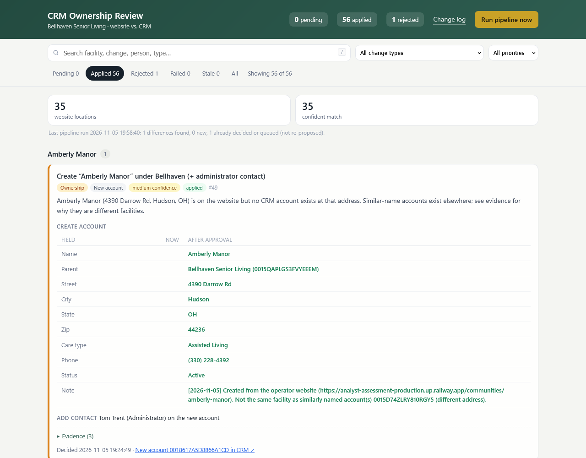

# CRM Ownership Review

A daily pipeline that keeps a CRM's picture of **which parent company owns each long-term care facility** accurate as facilities are bought, sold, rebranded and consolidated. It's built against a fictional operator, Bellhaven Senior Living, and a sandbox CRM API.

It scrapes the operator's website, matches every community to the CRM, and queues each proposed fix in a local **review app** along with its evidence. **Nothing is written to the CRM until a person approves it.**



## Results

| | |
|---|---|
| Website communities checked | 35 (34 in the directory + 1 linked only from the homepage) |
| CRM accounts reviewed | 121 (115 facilities, 6 parent companies) |
| Proposals approved / rejected | 56 / 1 |
| End state | **35 of 35** communities map to exactly one current account under Bellhaven, with the website's name, address, zip, phone and administrator |
| Full before → after list | [docs/changes-made.md](docs/changes-made.md) |

**On the first run,** 6 communities were already correct, 25 matched an account that needed a fix, 4 had no CRM account, and 3 accounts filed under Bellhaven were no longer on its website.

## How it works

```
 scrape.py ──► website snapshot ─┐
                                 ├──► match.py ──► proposals ──► review app (app.py) ──► apply.py ──► CRM API
 crm.py ────► CRM accounts ──────┘    (rules)       (SQLite)      approve / reject       (only writer)
```

1. **Scrape** (`scrape.py`): walks the paginated directory and crawls every page on the site, because new communities can be announced (e.g. on the homepage) before they reach the directory. It reads each community's detail page as the source of truth.
2. **Match and classify** (`match.py`): links each community to its CRM account by **normalized address** (street + city + state). Name, parent, address, zip, phone and administrator are then compared field by field.
3. **Queue** (`store.py`): every difference becomes one review item with plain-English evidence, a confidence level and a fingerprint, so re-runs never re-propose a decided item.
4. **Review** (`app.py`): approve or reject each item. An approval writes through the API, re-checks the CRM and surfaces any follow-up the approval made true, while the reviewer still has context.
5. **Run daily** (`pipeline.py`): `.github/workflows/daily.yml`, or the cron entry in `schedule/crontab.txt`.

The full matching approach, the billing SOP handling and every edge case are in **[docs/approach.md](docs/approach.md)**.

## Quick start

```bash
pip install -r requirements.txt
cp .env.example .env          # add API_TOKEN (and API_BASE_URL if different)
python pipeline.py --dry-run  # scrape + match, print the report, change nothing
python pipeline.py            # queue new proposals for review
python app.py                 # review at http://localhost:5000
```

`pipeline.py` never writes to the CRM. The only code path that writes is the review app's **Approve** button (`apply.py`).

## Safety

- **Human approval for every write,** including notes.
- **Billing SOP:** an account with revenue history *and* an outstanding balance is never re-parented. The old account is left exactly as it is, a new account is created under the new parent, and `chow_current_account` links them.
- **Stale check:** before writing, every account the proposal relied on is fetched again. If anything changed since the proposal was made, nothing is written.
- **Safe re-runs:** decided items are fingerprinted and never re-proposed, and records resolved as duplicates or changes of ownership are excluded from matching.
- **No partial data:** the scraper stops if the directory count doesn't match what the site says it lists, and a community counts as "removed" only when its own page returns 404.
- **Retry-safe writes:** progress is saved after each step, so a retry never creates the same account twice.
- **Notes are appended,** never overwritten.

## Tests

```bash
python tests/test_rerun.py      # approve every proposal on a copy of the CRM, re-run: nothing new is proposed
python tests/test_followup.py   # approvals trigger follow-ups at the right moment; notes append
python tests/audit_queue.py     # (live CRM, read-only) simulate approving the queue and audit the end state
```

The first two run offline against `tests/fixtures/` (the CRM and website as they were before any changes).

## Project layout

| File | Purpose |
|---|---|
| `scrape.py` | Website scraper with crawl, count check, snapshots, 404 re-check and retries |
| `crm.py` | CRM API client |
| `normalize.py` | Address, name and phone normalization (comparison only) |
| `match.py` | Matching, classification and proposal building |
| `store.py` | SQLite review queue and fingerprints |
| `apply.py` | Writes approved proposals (the only writer) |
| `pipeline.py` | Daily run and post-approval follow-ups |
| `app.py`, `templates/` | Review app |
| `report_changes.py` | Before → after report from a saved snapshot |
| `.github/workflows/daily.yml`, `schedule/crontab.txt` | Scheduling |

## What I'd build next

- **A second ownership source.** CMS publishes nursing-home ownership and change-of-ownership records keyed by CCN, a permanent federal ID, which would catch sales before an operator updates its website.
- **Review by acquisition, not just by facility.** Group the queue by parent company so a sale is reviewed as one event.
- **Tune rules from reviewer decisions:** for example, only propose "no current facilities" notes for companies acquired in full.
- **Rename detection in the scraper** (a slug change at the same address) and a care-type sync.
